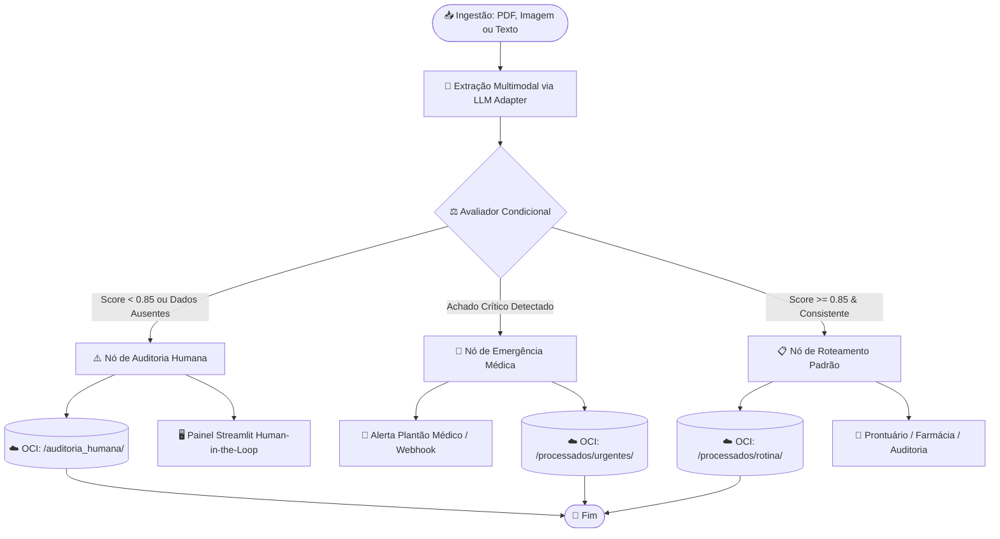

# 🏥 MediFlow — Agente Autônomo para Triagem Clínica

> Sistema inteligente e autônomo para classificação, extração multimodal estruturada e roteamento condicional de documentos clínicos com persistência em nuvem Oracle Cloud Infrastructure (OCI Always Free)[cite: 3, 5].

---

## 📌 Visão Geral do Projeto

O **MediFlow** processa fluxos documentais em saúde (receitas, laudos de exames, guias e atestados), mitigando atrasos operacionais e erros de digitação[cite: 3]. A solução combina **Clean Architecture**, **Hexagonal Architecture (Ports & Adapters)** e **Monólito Modular**, garantindo isolamento total das regras clínicas em relação a modelos de linguagem e provedores de nuvem.

---

## 🏛️ Diagrama do Fluxo de Decisão Condicional (LangGraph)

O fluxo operacional baseia-se num grafo de estados com arestas condicionais (*Conditional Edges*) para tratamento de urgências e contingência humana (*Human-in-the-Loop*):



---

## 📂 Estrutura Arquitetural do Repositório

```text
mediflow/
│
├── .env.example                     # Variáveis de ambiente (chaves de API, credenciais OCI)
├── .gitignore
├── README.md                        # Documentação da arquitetura, fluxos e execução
├── pyproject.toml                   # Dependências e metadados do projeto
├── Dockerfile                       # Containerização para deploy na VM OCI Always Free
├── docker-compose.yml               # Execução local da API FastAPI + UI Streamlit
│
├── config/                          # Configurações globais e carregamento de ambiente
│   ├── __init__.py
│   └── settings.py                  # Pydantic Settings (chaves, buckets OCI, thresholds)
│
├── domain/                          # NÚCLEO PURO: Regras clínicas e interfaces (Zero dependências externas)
│   ├── __init__.py
│   ├── entities/                    # Entidades do ecossistema clínico
│   │   ├── __init__.py
│   │   ├── paciente.py              # Identificação e dados demográficos
│   │   ├── documento_clinico.py     # Metadados do documento e hash de integridade
│   │   └── triagem.py               # Resultado do diagnóstico, prioridade e roteamento
│   ├── value_objects/               # Objetos de valor imutáveis
│   │   ├── __init__.py
│   │   ├── prioridade.py            # Enum: Rotina, Prioritário, Urgente
│   │   ├── score_confianca.py       # Validação de score (0.00 a 1.00)
│   │   └── cid.py                   # Validação de código CID-10
│   └── ports/                       # Interfaces abstratas / Portas Hexagonais (Protocol/ABC)
│       ├── __init__.py
│       ├── llm_port.py              # Contrato de extração multimodal e classificação
│       ├── storage_port.py          # Contrato de persistência de objetos e buckets
│       └── notifier_port.py         # Contrato para envio de alertas imediatos
│
├── application/                     # CASOS DE USO: Orquestração e fluxo de triagem
│   ├── __init__.py
│   ├── dtos/                        # Schemas Pydantic de entrada e saída (Contrato do Desafio)
│   │   ├── __init__.py
│   │   ├── input_request.py         # Schema da requisição JSON (documento_id, PDF/Base64/texto)
│   │   └── output_response.py       # Schema oficial com classificacao, dados_extraidos e roteamento
│   ├── workflows/                   # Grafo de decisão condicional (State Machine / LangGraph)
│   │   ├── __init__.py
│   │   ├── state.py                 # Estado do fluxo de triagem clínica
│   │   ├── nodes.py                 # Nós: classificar, extrair, avaliar_confianca, rotear
│   │   └── edges.py                 # Arestas condicionais: urgência vs rotina vs revisão humana
│   └── use_cases/                   # Serviços de aplicação
│       ├── __init__.py
│       ├── processar_triagem.py     # Fluxo principal de ingestão, análise e persistência
│       └── auditar_documento.py     # Resolução de casos com baixa confiança por humanos
│
├── infrastructure/                  # ADAPTADORES: Implementações tecnológicas externas
│   ├── __init__.py
│   ├── adapters/                    # Implementação concreta das Portas da camada de Domínio
│   │   ├── __init__.py
│   │   ├── gemini_llm_adapter.py    # Integração multimodal com Google GenAI SDK (Gemini)
│   │   ├── openai_llm_adapter.py    # Fallback/Alternativa para GPT-4o
│   │   ├── oci_storage_adapter.py   # SDK oci.object_storage (Always Free Buckets)
│   │   └── webhook_notifier.py      # Notificador de plantão médico (Slack/Email/Webhook)
│   └── oci_client/                  # Configuração de autenticação OCI (API Key / Instance Principal)
│       ├── __init__.py
│       └── client_factory.py
│
├── presentation/                    # APRESENTAÇÃO: Exposição de interfaces e endpoints
│   ├── __init__.py
│   ├── api/                         # API REST para ingestão e automações
│   │   ├── __init__.py
│   │   ├── main.py                  # Inicialização da aplicação FastAPI
│   │   └── routers/
│   │       ├── __init__.py
│   │       ├── triagem_router.py    # Endpoint POST /triagem
│   │       └── health_router.py     # Endpoint GET /health
│   └── web/                         # Painel de Auditoria Human-in-the-Loop
│       ├── app.py                   # Aplicação Streamlit
│       ├── components/              # Componentes de visualização (exibição de PDF e extração)
│       └── views/
│           ├── fila_urgencias.py    # Visualização de casos urgentes
│           └── auditoria.py         # Aprovação/rejeição com um clique de casos ambíguos
│
└── tests/                           # Suíte de testes automatizados
    ├── conftest.py                  # Mocks de LLM e OCI Object Storage
    ├── unit/                        # Testes das regras de negócio do Domínio
    └── integration/                 # Testes dos 3 cenários obrigatórios (Rotina, Urgência, Ambiguidade)

```

---

## ⚙️ Pré-requisitos e Configuração

### 1. Clonar o Repositório e Configurar Variáveis

```bash
git clone https://github.com/HilarioGouveia/mediflow.git
cd mediflow
cp .env.example .env


```

Edite o ficheiro `.env` com as credenciais necessárias:

```ini
GEMINI_API_KEY="sua_chave_gemini"
OCI_CONFIG_FILE="~/.oci/config"
OCI_CONFIG_PROFILE="DEFAULT"
OCI_NAMESPACE="seu_tenancy_namespace"
OCI_BUCKET_NAME="mediflow-documentos-clinicos"

```

### 2. Execução Rápida via Docker Compose

Para iniciar a API FastAPI (porta 8000) e a UI Streamlit (porta 8501) simultaneamente:

```bash
docker-compose up --build -d

```

---

## 🧪 Demonstração dos 3 Cenários Obrigatórios

Execute o script automatizado para verificar a conformidade dos três cenários avaliados:

```bash
python tests/demonstracao_cenarios.py

```

| Cenário | Entrada | Decisão do Grafo | Destino OCI Always Free |
| --- | --- | --- | --- |
| **1. Rotina**<br> | Receita médica ambulatorial legível.

 | Aprovado automaticamente sem contingência humana.

 | `processados/rotina/`<br> |
| **2. Urgência**<br> | Laudo de imagem com TEP agudo detectado.

 | `Fila_Emergencia_Medica` + Disparo imediato de alerta.

 | `processados/urgentes/`<br> |
| **3. Ambiguidade**<br> | Documento rasurado ou CRM ausente (score < 0.85).

 | `requer_auditoria_humana: true` $\rightarrow$ Fila Streamlit.

 | `auditoria_humana/`<br> |

---

## ☁️ Oracle Cloud Infrastructure (OCI Always Free)

A persistência do MediFlow está alinhada às restrições de custo zero do programa ONE:

* **OCI Object Storage**: Organização lógica de buckets por status (`/recebidos`, `/processados`, `/auditoria_humana`).

* **OCI Compute Instance (Opcional)**: Execução conteinerizada via VM Ampere A1 (ARM) ou AMD Micro da camada Always Free.


## Estado de validacao (17/10/2026)

Os sete testes unitarios passaram com dependencias simuladas. A homologacao de emergencia
persiste o registro antes de chamar o notificador; a resposta inclui `notificacao_enviada`.
Uma falha de notificacao nao desfaz a homologacao.

```powershell
python -m venv .venv
.\.venv\Scripts\Activate.ps1
python -m pip install -r requirements.txt
Copy-Item .env.example .env
python -m pytest tests/unit
python -m uvicorn presentation.api.main:app --host 127.0.0.1 --port 8000
```

Em outro terminal, com o ambiente virtual ativado:

```powershell
python -m streamlit run presentation/web/app.py
```

Edite `.env` com suas configuracoes. `WEBHOOK_URL` e opcional; sem URL, o notificador
registra o alerta apenas em log. O retorno positivo do notificador nesse modo nao
comprova entrega a uma equipe externa.

Sem configuracao OCI valida, o armazenamento usa memoria local, perde os dados ao
reiniciar e pode retornar `status_backup="sucesso"` para operacoes simuladas.
Esse modo nao comprova persistencia em nuvem. Para Docker, as credenciais OCI e a
chave privada precisam ser disponibilizadas por montagem de volume, com caminhos
validos dentro do container; o Compose atual nao configura essa montagem.

A conexao real com Gemini terminou em `ConnectError` nas verificacoes. OCI real e
webhook externo permanecem sem validacao. Os tres cenarios em
`tests/demonstracao_cenarios.py` exigem a API ativa na porta 8000 e configuracao de IA;
execute-os separadamente dos testes unitarios. Os indicadores da interface ainda sao
valores fixos de demonstracao.

Pendencia conhecida: falhas ao salvar o documento original podem ser reportadas
como sucesso pelo caso de uso; o retorno de `salvar_arquivo` precisa ser verificado.

Nao versione `.env`, ambientes virtuais, credenciais OCI ou chaves privadas.
