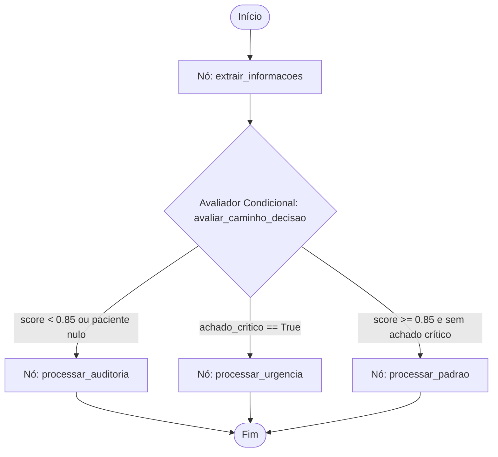

# Documento de Design de Software (SDD) — MediFlow

**Projeto:** MediFlow — Agente Autônomo para Triagem, Extração e Roteamento de Documentos Clínicos

**Versão:** 1.0.0

**Status:** Aprovado para Implementação / MVP

**Ecossistema:** Python 3.11, Oracle Cloud Infrastructure (OCI Always Free), LangGraph, FastAPI, Streamlit

---

## 1. Visão Geral e Objetivos do Sistema

### 1.1 Contexto e Justificativa de Negócio

Ambientes hospitalares, clínicas e operadoras de saúde processam volumes massivos de laudos, prescrições, atestados e guias TISS/TUSS diariamente. O trabalho manual de digitação e triagem gera atrasos no fluxo de pronto-atendimento e custos com glosas hospitalares. O **MediFlow** provê um pipeline autônomo com inteligência multimodal para classificar documentos clínicos, extrair dados essenciais estruturados, aplicar regras de contingência (*Human-in-the-Loop*) e persistir o ciclo de vida documental em nuvem com custo zero.

### 1.2 Requisitos Mandatórios (MVP)

* **Ingestão Multimodal:** Processamento uniforme de arquivos em PDF, imagens (JPG/PNG), dados em JSON e texto clínico plano.

* **Classificação e Extração Estruturada:** Identificação da categoria documental e extração tipada de dados do paciente, médico solicitante (CRM), hipótese diagnóstica, CID-10 e medicamentos utilizando LLMs.

* **Grafo de Decisão Condicional:** Orquestração de regras clínicas com nós e arestas condicionais (*Conditional Edges*) para desvio imediato de urgências ou retenção para auditoria humana.

* **Persistência OCI Object Storage Always Free:** Segregação de arquivos e metadados nos prefixos `/recebidos`, `/processados` (subpastas `/urgentes`, `/rotina`, `/prioritarios`) e `/auditoria_humana`.

* **Interfaces do Sistema:** API REST via FastAPI para automações e painel web via Streamlit para gestão e auditoria.

---

## 2. Arquitetura do Sistema

O sistema combina **Arquitetura Hexagonal (Ports & Adapters)**, **Clean Architecture** e **Monólito Modular**. As regras clínicas e entidades operam no núcleo central, enquanto serviços de IA, provedores de nuvem e bibliotecas web funcionam como adaptadores externos intercambiáveis.

```
┌────────────────────────────────────────────────────────────────────────┐
│                        PRESENTATION LAYER                              │
│   FastAPI Endpoints (/triagem, /health)  │  Streamlit UI & Dashboards  │
└───────────────────────────────────┬────────────────────────────────────┘
                                    │ Chama DTOs / Casos de Uso
┌───────────────────────────────────▼────────────────────────────────────┐
│                        APPLICATION LAYER                               │
│  • Schemas Pydantic (Input/Output DTOs)                                │
│  • Workflows & Grafo Condicional LangGraph (State, Nodes, Edges)       │
│  • Casos de Uso: ProcessarTriagemUseCase                               │
└───────────────────┬────────────────────────────────┬───────────────────┘
                    │                                │
    Implementa Portas│                                │ Depende do Domínio Puro
                    │                                │
┌───────────────────▼──────────────┐   ┌─────────────▼───────────────────┐
│       INFRASTRUCTURE LAYER       │   │          DOMAIN LAYER           │
│  • GeminiLLMAdapter              │   │  • Entidades: TriagemClinica,   │
│  • OpenAILLMAdapter (Fallback)   │   │    Paciente, DocumentoClinico   │
│  • OCIStorageAdapter             │   │  • Value Objects: CID10,        │
│  • WebhookNotifierAdapter        │   │    NivelPrioridade, Score       │
│  • OCI Client Factory            │   │  • Interfaces (Ports): LLMPort, │
│                                  │   │    StoragePort, NotifierPort    │
└──────────────────────────────────┘   └─────────────────────────────────┘

```

### 2.1 Camadas do Sistema

1. **Domain (Núcleo Puro):** Isento de dependências de bibliotecas de terceiros. Contém a lógica das entidades clínicas, cálculo de hash criptográfico de integridade e objetos de valor com validações matemáticas e clínicas.

2. **Application (Orquestração):** Define os contratos de entrada e saída via Pydantic (`TriagemRequestDTO`, `TriagemResponseDTO`), a máquina de estados do LangGraph e o caso de uso `ProcessarTriagemUseCase`.

3. **Infrastructure (Adaptadores Técnicos):** Implementações concretas das portas abstratas. Integra o SDK `google-genai` para extração multimodal com *Structured Outputs*, SDK `oci` para persistência em Object Storage e webhooks de notificação.

4. **Presentation (Apresentação):** Routers modulares FastAPI para comunicação HTTP REST e interface web Streamlit para visualização assistida por humanos.

---

## 3. Modelo de Dados e Contratos de Interface

### 3.1 DTO de Entrada (`TriagemRequestDTO`)

Valida os formatos permitidos e a origem antes de disparar o fluxo:

```python
class TipoArquivoEnum(str, Enum):
    PDF = "PDF"
    IMAGEM = "IMAGEM"
    JSON = "JSON"
    TEXTO = "TEXTO"

class TriagemRequestDTO(BaseModel):
    documento_id: str
    tipo_arquivo: TipoArquivoEnum
    documento_texto: Optional[str] = None
    arquivo_base64: Optional[str] = None
    canal_origem: str

```

### 3.2 DTO de Saída Padronizado (`TriagemResponseDTO`)

Estrutura de resposta devolvida pelo endpoint e persistida no OCI:

```json
{
  "status": "processado",
  "documento_id": "DOC-CLIN-2026-8942",
  "classificacao": {
    "tipo_documento": "Laudo de Exame de Imagem",
    "especialidade": "Radiologia / Pneumologia",
    "nivel_prioridade": "Urgente",
    "score_confianca_classificacao": 0.99
  },
  "dados_extraidos": {
    "paciente": { "nome": "Carlos Eduardo Mendes", "idade": 52 },
    "medico_solicitante": { "nome": "Dra. Renata Silveira", "crm": "145892-SP" },
    "exame_realizado": "Tomografia de Torax com contraste",
    "diagnostico_principal": "Tromboembolismo Pulmonar Agudo (TEP)",
    "cid_sugerido": "I26.9",
    "medicamentos": []
  },
  "decisao_roteamento": {
    "destino_principal": "Fila_Emergencia_Medica",
    "requer_auditoria_humana": false,
    "justificativa_roteamento": "Achado critico de alta gravidade (TEP agudo) detectado em paciente sintomatico.",
    "notificacao_gerada": {
      "canal": "Alerta_Plantao_Medico",
      "mensagem": "ALERTA URGENTE: Laudo critico de TEP Agudo para paciente Carlos Eduardo Mendes no Pronto-Socorro."
    }
  },
  "armazenamento_oci": {
    "bucket": "mediflow-documentos-clinicos",
    "caminho_objeto": "processados/urgentes/DOC-CLIN-2026-8942.json",
    "status_backup": "sucesso"
  }
}

```

---

## 4. Design do Grafo Condicional (LangGraph)

O fluxo de decisão modela a tomada de decisão clínica dividida em nós funcionais e uma aresta condicional avaliadora:



### 4.1 Nós e Regras de Transição

* **Nó `extrair_informacoes`:** Consome o `LLMPort` com base64 ou texto puro, recebendo a estrutura `ExtracaoClinicaLLMSchema` contendo `score_confianca`, `achado_critico` e entidades médicas.

* **Aresta `avaliar_caminho_decisao`:**
* **Condição 1 (Contingência Humana):** Se $\text{score} < 0.85$ ou nome do paciente ausente $\rightarrow$ Desvia para `rota_auditoria`.

* **Condição 2 (Urgência Médica):** Se `achado_critico` for verdadeiro $\rightarrow$ Desvia para `rota_urgencia`.

* **Condição 3 (Rotina Automática):** Caso contrário $\rightarrow$ Desvia para `rota_padrao`.

* **Nó `processar_urgencia`:** Define destino como `Fila_Emergencia_Medica`, gera payload de alerta imediato para `Alerta_Plantao_Medico` e programa o prefixo `processados/urgentes/{id}.json`.

* **Nó `processar_padrao`:** Roteia dinamicamente conforme a categoria (Receituário $\rightarrow$ `Farmacia_Hospitalar`, Guias $\rightarrow$ `Auditoria_de_Autorizacoes`, Outros $\rightarrow$ `Prontuario_Eletronico_Paciente`) e programa o prefixo `processados/{prioridade}/{id}.json`.

* **Nó `processar_auditoria`:** Marca `requer_auditoria_humana = True`, destina para `Fila_Revisao_Humana` e programa o prefixo `auditoria_humana/{id}.json`.

---

## 5. Estratégia de Nuvem: OCI Always Free

Para operar dentro das restrições de custo zero do programa ONE:

* **OCI Object Storage:**
* **Bucket Principal:** `mediflow-documentos-clinicos`.

* **Prefixos Virtuais Segregados:**
* `/recebidos/`: Armazena o binário original ingerido (PDF ou imagem).

* `/processados/urgentes/`: Metadados e respostas de casos críticos com despacho imediato.

* `/processados/rotina/` e `/processados/prioritarios/`: Documentos processados com alta confiabilidade.

* `/auditoria_humana/`: Casos retidos com inconsistências aguardando intervenção manual.

* **OCI Compute Instance (Deploy Opcional):** VM Always Free (Ampere ARM A1 ou AMD Micro) executando os contêineres Docker da API e UI.

---

## 6. Plano de Testes e Validação dos Cenários Canônicos

A conformidade do software é atestada pela execução da suíte de integração cobrindo os 3 cenários canônicos:

| ID | Cenário | Entrada | Comportamento Esperado | Destino no Grafo | Status OCI |
| --- | --- | --- | --- | --- | --- |
| **TC-01** | **Rotina Aprovada**<br> | Receita ambulatorial com texto legível, paciente, CRM e posologia.

 | Score $\ge 0.85$, sem achados críticos.

 | `Farmacia_Hospitalar`<br> | `processados/rotina/`<br> |
| **TC-02** | **Urgência Crítica**<br> | Laudo de imagem indicando Tromboembolismo Pulmonar Agudo (TEP).

 | Detecção de achado crítico, notificação disparada.

 | `Fila_Emergencia_Medica`<br> | `processados/urgentes/`<br> |
| **TC-03** | **Ambiguidade / Contingência**<br> | Documento escaneado rasurado com ausência de CRM e nome ilegível.

 | Score $< 0.85$, ativação de fallback.

 | `Fila_Revisao_Humana`<br> | `auditoria_humana/`<br> |

---

## 7. Rastreabilidade de Arquivos do Projeto

A organização dos componentes do repositório mapeia estritamente os padrões arquiteturais especificados:

```text
mediflow/
├── config/
│   └── settings.py                  # Gestão de credenciais e variáveis de ambiente
├── domain/
│   ├── entities/
│   │   ├── paciente.py              # Regras demográficas e faixa etária prioritária[cite: 36]
│   │   ├── documento_clinico.py     # Metadados e cálculo de hash SHA-256[cite: 35]
│   │   └── triagem.py               # Entidade pura de decisão clínica[cite: 37]
│   ├── value_objects/
│   │   ├── cid.py                   # Validação de formato e gravidade CID-10[cite: 41]
│   │   ├── prioridade.py            # Taxonomia e pesos Manchester[cite: 42]
│   │   └── score.py                 # Validação de threshold (corte em 0.85)[cite: 43]
│   └── ports/
│       ├── llm_port.py              # Interface abstrata de inteligência multimodal[cite: 38]
│       ├── storage_port.py          # Interface abstrata de persistência em nuvem[cite: 40]
│       └── notifier_port.py         # Interface abstrata de envio de alertas[cite: 39]
├── application/
│   ├── dtos/
│   │   ├── input_request.py         # Schema de entrada validado[cite: 18]
│   │   └── output_response.py       # Contrato de resposta final do desafio[cite: 19]
│   ├── workflows/
│   │   ├── state.py                 # Estado compartilhado do grafo LangGraph[cite: 17]
│   │   ├── nodes.py                 # Execução dos nós da máquina de estados[cite: 16]
│   │   └── graph.py                 # Compilação e arestas condicionais[cite: 15]
│   └── use_cases/
│       └── processar_triagem.py     # Caso de uso principal de ponta a ponta[cite: 20]
├── infrastructure/
│   ├── adapters/
│   │   ├── gemini_llm_adapter.py    # Adaptador primário multimodal com SDK Google GenAI[cite: 21]
│   │   ├── openai_llm_adapter.py    # Adaptador de contingência via GPT-4o[cite: 23]
│   │   ├── oci_storage_adapter.py   # Adaptador de integração SDK OCI Always Free[cite: 22]
│   │   ├── webhook_notifier.py      # Adaptador de notificações e webhooks[cite: 25]
│   │   └── schemas_llm.py           # Schemas Pydantic para Structured Outputs da LLM[cite: 24]
│   └── oci_client/
│       └── client_factory.py        # Provedor singleton para injeção de dependência
├── presentation/
│   ├── api/
│   │   ├── main.py                  # Inicialização da API FastAPI[cite: 26]
│   │   └── routers/
│   │       ├── health_router.py     # Liveness e Readiness checks[cite: 27]
│   │       └── triagem_router.py    # Endpoints de triagem (JSON e Upload)[cite: 28]
│   └── web/
│       ├── app.py                   # Ponto de entrada da interface Streamlit[cite: 34]
│       ├── components/
│       │   ├── clinical_card.py     # Renderização visual dos cartões clínicos[cite: 30]
│       │   └── pdf_viewer.py        # Renderizador de PDF e imagem Base64[cite: 31]
│       └── views/
│           ├── fila_urgencias.py    # Dashboard da equipe médica para emergências[cite: 33]
│           └── auditoria.py         # Tela Human-in-the-Loop de resolução com 1 clique[cite: 32]
├── tests/
│   └── demonstracao_cenarios.py     # Script executável dos 3 casos de teste obrigatórios
├── Dockerfile                       # Build conteinerizado otimizado[cite: 11]
├── docker-compose.yml               # Orquestração local da API e Streamlit[cite: 10]
├── requirements.txt                 # Dependências fixadas[cite: 14]
└── README.md                        # Documentação técnica e instruções operacionais[cite: 13]

```
